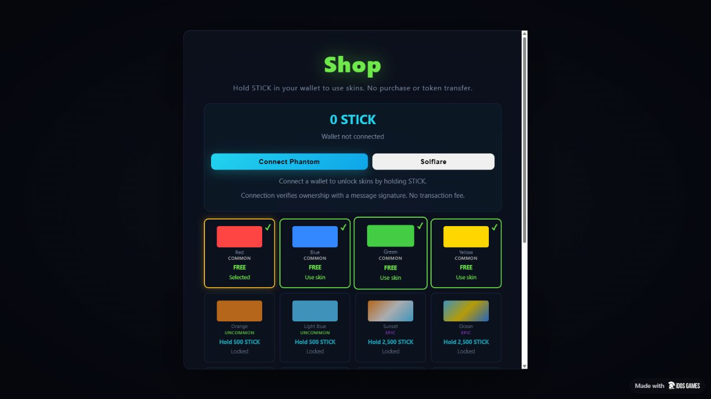
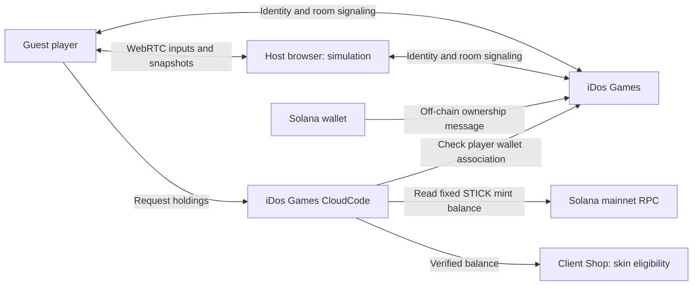

# SolSnake — Multiplayer Snake Arena

> A browser snake game on iDos Games: join friends by room code and unlock cosmetic skins by holding STICK in a verified Solana wallet.

[Live Demo](https://fpc8nue4.idos.games/) · [Docs](docs/architecture.md) · [Token Utility](docs/token-utility.md)


---

## Submission to 2026 Solana National Hackathon

| Name | Role | Contact |
| --- | --- | --- |
| Дмитрий / Dmitry | Solo founder and builder | [GitHub](https://github.com/dmitrydima202) |

Project materials prepared for a portfolio and hackathon. Submission and acceptance have not been confirmed. The game is a playable prototype; no user-growth or revenue figures are claimed.

---

## Problem and Solution

### 1. Getting friends into the same game

- **Problem:** Players need a simple way to share an arena.
- **SolSnake:** Create a room, share its eight-character code, and join directly from the browser.

### 2. Giving a game token visible utility

- **Problem:** A game token needs a clear use inside the game.
- **SolSnake:** STICK holdings determine access to cosmetic skins. The minimum balance equals each skin's former game-currency price: for example, Rainbow requires 10,000 STICK. Tokens stay in the wallet.

### 3. Keeping entry simple

- **Problem:** Requiring a wallet before playing adds friction.
- **SolSnake:** Local play and guest rooms work with four free colors. A wallet is needed only for holder cosmetics.

These are product hypotheses; demand and retention have not been measured.

---

## Why Solana

- **Existing token:** SolSnake uses the STICK token attached to iDos Games title `FPC8NUE4`; a new SNAKE token is not being launched.
- **Readable holdings:** CloudCode queries confirmed token accounts for a verified wallet and the fixed STICK mint, summing balances with six decimals.
- **No payment for access:** Connecting proves wallet ownership with an off-chain message. The game reads holdings without transferring or spending tokens.
- **Off-chain gameplay:** Movement, collisions and multiplayer simulation run in a player's browser; no custom Solana program is deployed by this repository.

Mint: `CdomqHDyfMGEDPpBzgLHMaP9N6DTnSfkW36dh8eSidos`.

See [token utility and verification limits](docs/token-utility.md).

---

## Summary of Features

- Canvas arena: eat food, grow, boost and avoid collisions.
- Local play with bots.
- Room creation, code sharing, joining and leaving.
- Browser-hosted WebRTC multiplayer; configured room capacity of eight players.
- Phantom / Solflare connection on the direct game URL and the iDos Games wallet bridge inside the platform.
- CloudCode verification of wallet association and read-only STICK balance checks.
- Holding tiers of 500, 1,000, 2,500, 5,000, 10,000 and 25,000 STICK; four free colors.
- Balance refresh every 30 seconds and before play/respawn; unavailable or stale eligibility restores a free skin.



**Verification:** Six automated checks cover thresholds, exact balances, ownership rejection, RPC failure, skin protocol validation and access revocation. The production build and free-skin Shop/play flows passed. Earlier room testing used two distinct guest clients. A real holder's wallet-signing and unlock flow still needs an end-to-end check; eight-player load and broad network compatibility remain untested.

**Limitations:** The browser host controls the simulation and can modify it. Cosmetic selection is applied by the client; this is not tamper-proof entitlement enforcement. Host handover starts a fresh round. RPC outages temporarily lock holder skins. The wallet must be connected again after a page reload.

---

## Tech Stack

| Layer | Technology |
| --- | --- |
| Frontend | JavaScript ES modules · HTML Canvas · CSS |
| Build | Vite 7.3.7 |
| Game simulation | Shared JavaScript world in the host browser |
| Identity and room signaling | `@idosgames/core` 0.21.5 |
| Wallet connection | `@idosgames/wallet` 0.6.4 |
| Multiplayer transport | iDos Games `RealtimeSession` · WebRTC |
| Token balance service | iDos Games CloudCode · Solana mainnet JSON-RPC |
| Testing | Node.js built-in test runner |
| Distribution | iDos Games static hosting |

---

## Architecture



The platform manages room signaling and the balance handler. A player's browser runs the arena. Room codes are invitations backed by public room names, not secret passwords.

See [docs/architecture.md](docs/architecture.md) for components and trust boundaries.

---

## Quick Start

Prerequisite: Node.js 22.12 or newer.

```bash
git clone https://github.com/dmitrydima202/SolSnake.git
cd SolSnake
npm ci
npm test
npm run dev
```

Open the address printed by Vite. Build for hosting with `npm run build`; output is in `dist/` with relative asset paths. `src/idos.title.js` targets `FPC8NUE4`. Local development uses the configured platform title for online services; running Vite alone does not deploy CloudCode.

### Play with friends

1. Choose **Play Online → Create room**.
2. Copy and share the room code.
3. Friends enter the code and choose **Join**.
4. Each player chooses **Play in room**.
5. **Leave room** returns to local play.

Use separate browser profiles or separate origins for distinct guest identities; tabs on one origin may share a guest identity.

### Try holder cosmetics

Open **Skins / Shop → Connect wallet**, approve the ownership message in your wallet, and refresh the balance. A sufficient STICK balance enables the corresponding skin and all lower tiers. No tokens are charged. See [CloudCode deployment instructions](docs/token-utility.md#deployment).

| Action | Input |
| --- | --- |
| Steer | Mouse movement or touch |
| Boost | Hold mouse button / Space / touch Boost |
| Respawn | Play Again / Enter |
| Low graphics | G |

---

## Roadmap

- [x] Publish a playable browser prototype on iDos Games.
- [x] Add room creation, code sharing and joining.
- [x] Check one room with two distinct guest clients.
- [x] Use the existing title's STICK mint and original skin-price thresholds.
- [x] Implement wallet connection and verified-wallet balance checks.
- [x] Publish the holder Shop, periodic refresh and access revocation.
- [x] Add six automated checks and production build validation.
- [ ] Verify a real holder's signing, unlock and balance-change flow end to end.
- [ ] Test cross-network rooms, host departure and eight-player load.
- [ ] Measure player participation and repeat play.
- [ ] Evaluate stronger cosmetic enforcement and a dedicated simulation service.

Full roadmap: [docs/roadmap.md](docs/roadmap.md).

---

## Resources

- [Live Application](https://fpc8nue4.idos.games/)
- [iDos Games application page](https://idosgames.com/app/FPC8NUE4/)
- [Architecture](docs/architecture.md)
- [STICK token utility](docs/token-utility.md)
- [Original Project Presentation](docs/SolSnake.pptx) — historical pitch with the earlier planned SNAKE token; it has not yet been updated to STICK. Current implementation is described above.
- Video demo and social links: not provided.

---

## License

The supplied `slither.clone` package declares MIT, but its archive did not include standalone upstream license text or verified author attribution. No new repository-wide license grant is asserted. See [NOTICE.md](NOTICE.md) for provenance and third-party notices.

Documentation follows the structure of [Marakaya/colosseum_example](https://github.com/Marakaya/colosseum_example), with project-specific content. Presentation design credits the supplied Superteam / Spacekayak template. These are references, not endorsements or partnerships.
