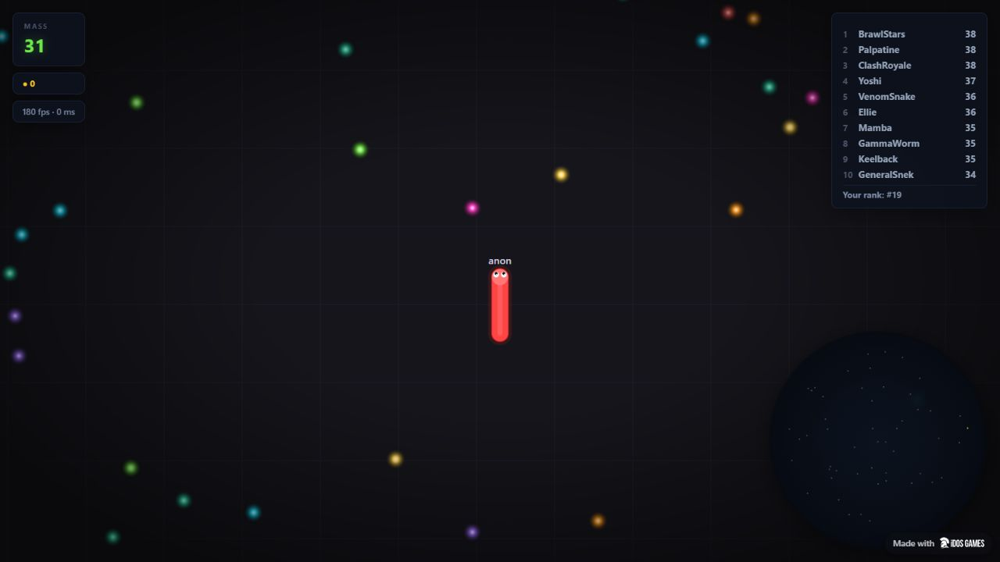
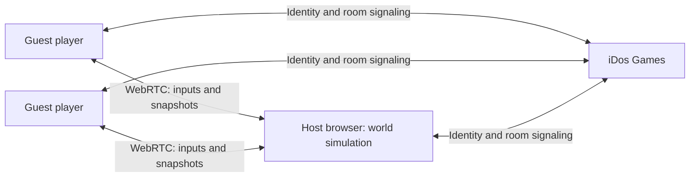

# SolSnake


> A browser snake arena with multiplayer rooms. Planned SNAKE token utility: unlock cosmetic skins by holding tokens in your wallet.

[Play the live game](https://fpc8nue4.idos.games/) · [Architecture](docs/architecture.md) · [Roadmap](docs/roadmap.md) · [Presentation](docs/SolSnake.pptx)



## Project and Team

| Name | Role |
| --- | --- |
| Дмитрий / Dmitry | Solo founder and builder |

This repository contains the iDos Games browser edition. The live game is a prototype; the SNAKE token and wallet-based skin access are planned features. No hackathon acceptance, token deployment, user-growth figures or revenue are claimed.

## Problem and Solution

### Playing with friends

Players need an easy way to reach the same arena. SolSnake lets one player create a room and share an eight-character code; friends enter that code and join the same game.

### Giving a game token cosmetic utility

The intended SNAKE mechanic links token holdings to visible cosmetic options. A qualifying wallet balance would unlock skins without spending those tokens. This is a product hypothesis to test, not validated demand.

### Keeping the game playable without a wallet

The current game runs in the browser with bots and guest multiplayer sessions. The proposed wallet flow applies to cosmetic eligibility, while the real-time simulation remains off-chain.

## Why Solana

SNAKE is planned as the game's own token on Solana, linked to SolSnake on iDos Games. The proposed integration would verify wallet control and read holdings for the selected mint before deciding which skins are available.

Solana exposes token-account reads through [`getTokenAccountsByOwner`](https://solana.com/docs/rpc/http/gettokenaccountsbyowner). This is a basis for the planned balance check; it is not implemented in this repository yet. Mint address, balance thresholds and the balance recheck policy are still to be defined.

There is no deployed Solana program, wallet connection or live SNAKE mint in the current MVP. See [the planned token design](docs/token-utility.md).

## Summary of Features

- Canvas snake arena: eat food, grow, boost and avoid collisions.
- Local play with bots.
- Create a room, copy its code and join a friend's room.
- Up to eight players per room; this is configured capacity, not a load-test result.
- Browser-hosted simulation using iDos Games WebRTC sessions.
- Skin selection and a shop interface with in-game currency prices.
- Planned: wallet authentication, SNAKE balance checks and cosmetic eligibility.

**Current limitations:** Shop purchase and daily-reward messages are not handled by the browser networking adapter. Wallet-based access is not implemented. The host browser controls the simulation; it depends on the host's connection and can be modified by that host. Host handover starts a fresh round rather than preserving the arena.

## Tech Stack

| Layer | Technology |
| --- | --- |
| Client and rendering | JavaScript ES modules · HTML Canvas · CSS |
| Build | Vite 7.3.7 |
| Game simulation | Shared JavaScript world running in the host browser |
| Guest identity and room signaling | `@idosgames/core` 0.21.5 |
| Peer transport | iDos Games `RealtimeSession` · WebRTC |
| Distribution | iDos Games static game hosting |
| Planned token utility | Solana wallet proof and SPL token balance checks |

## Architecture



The platform manages room membership and signaling. Game state is calculated by a player's browser; iDos Games is not running a dedicated SolSnake simulation server.

Room codes are invitation identifiers backed by public room names, not secret passwords. Empty or expired rooms cannot be joined. See [architecture and trust boundaries](docs/architecture.md).

## Quick Start

**Prerequisite:** Node.js 22.12 or newer.

```bash
npm ci
npm run dev
```

Open the address printed by Vite. To build:

```bash
npm run build
```

The output is in `dist/`. The Vite build uses a relative asset base for iDos Games hosting. `src/idos.title.js` currently identifies the SolSnake title `FPC8NUE4`; use your own configured title when deploying a separate game.

### Play with friends

1. Choose **Play Online → Create room**.
2. Use **Copy code** and share the code with your friends.
3. Friends choose **Play Online**, enter the code and press **Join**.
4. Each participant presses **Play in room** after connecting.
5. Use **Leave room** from the menu to return to local play.

For local testing with distinct guest identities, use separate browser profiles or the `localhost` and `127.0.0.1` origins. Tabs sharing the same origin may share the same guest identity.

### Controls

| Action | Input |
| --- | --- |
| Steer | Mouse movement or touch |
| Boost | Hold mouse button / Space / touch Boost |
| Respawn | Play Again / Enter |
| Low graphics | G |

## Validation

The browser edition was built and published on iDos Games. Two distinct guest clients were observed creating/joining one room by code and entering the game. Invalid-code feedback, copying a code, leaving and rejoining were checked. These checks do not establish eight-player capacity under load, broad network compatibility or resistance to a malicious host.

## Roadmap

- [x] Publish the playable browser prototype on iDos Games.
- [x] Add room creation, code sharing and joining.
- [x] Check gameplay with two distinct guest clients.
- [ ] Choose SNAKE mint, token standard and skin balance thresholds.
- [ ] Connect a wallet and verify control of its address.
- [ ] Implement trusted balance checks and cosmetic eligibility.
- [ ] Define what happens when the token balance falls below a threshold.
- [ ] Test holder access, room stability and player retention.
- [ ] Decide whether public arenas need a dedicated simulation server.

Full roadmap: [docs/roadmap.md](docs/roadmap.md).

## Resources

- [Live application](https://fpc8nue4.idos.games/)
- [iDos Games application page](https://idosgames.com/app/FPC8NUE4/)
- [Project presentation](docs/SolSnake.pptx)
- [Architecture](docs/architecture.md)
- [Token utility proposal](docs/token-utility.md)

## Attribution and License

This edition adapts the supplied `slither.clone` codebase; the original package declares MIT, but no standalone upstream license text was present in the supplied files. Upstream author and licensing provenance should be confirmed before broader redistribution. No new license grant is asserted here. See [NOTICE.md](NOTICE.md).

Documentation structure follows [Marakaya/colosseum_example](https://github.com/Marakaya/colosseum_example), adapted to the actual SolSnake implementation. Presentation design follows the supplied Superteam / Spacekayak template. These references are not endorsements or partnerships.
